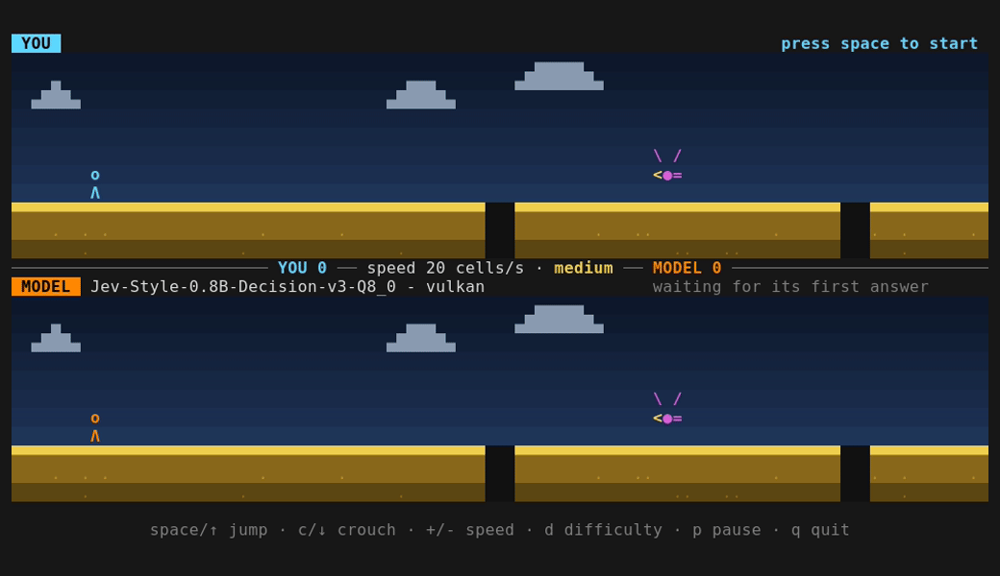

# Kronk Jev Game

An endless runner in the terminal.

You play the top half, a local AI decision model
plays the same map in the bottom half, at the same time.

Can decision models be fast enough to play games ?



## Contents

- [Goal](#goal)
- [Quick start](#quick-start)
- [Controls](#controls)
- [Options](#options)
- [Rules](#rules)
- [How the model plays](#how-the-model-plays)
- [Results](#results)
- [Project layout](#project-layout)
- [Credits](#credits)

## Goal

Experiment to see how well local *decision models* perform when run with
[Kronk](https://github.com/ardanlabs/kronk), a Go runtime for local models on
top of llama.cpp.

A decision model doesn't generate text. It picks one option from a list, in a
single forward pass, so it can answer much faster than a large language
model. A game is a good test: the model must be right, and it must be right in time.

The default model is
[Jev-Style-0.8B-Decision-v3](https://huggingface.co/chaoliangUNSW/Jev-Style-0.8B-Decision-v3-GGUF).
With it, each answer takes about 80 ms on an integrated GPU, fast enough to
time its jumps. See [Results](#results) for the numbers.

## Quick start

Run the game with Go or with Docker. Either way, you need `make` and a
terminal of at least 64 columns by 27 rows.

The game starts paused. Press `space` to go. Press `q` to quit and see a recap.

### With Go

You need Go 1.27 or later. Then:

```shell
git clone https://github.com/ekkinox/kronk-jev-game.git
cd kronk-jev-game
make run
```

The first run downloads llama.cpp and the model (about 900 MB) into
`~/.kronk-game`. Later runs start in a second or so.

It runs on Linux and macOS, on an NVIDIA GPU (CUDA), an AMD or Intel GPU
(Vulkan), Apple Silicon (Metal), or the CPU. The right one is picked for you.

### With Docker

You need Docker, not Go. Then:

```shell
git clone https://github.com/ekkinox/kronk-jev-game.git
cd kronk-jev-game
make docker-build
make docker-run
```

`make docker-build` puts llama.cpp and the model in the image (about 2 GB), so
the game starts right away. It picks the same GPU as `make run`, and
`make docker-run` gives the container access to it. `SPEED`, `DIFFICULTY` and
`SEED` work with `make docker-run`. `MODEL` goes to `make docker-build`.

- **AMD or Intel GPU**: works on Linux, through Vulkan.
- **NVIDIA GPU**: needs the
  [NVIDIA Container Toolkit](https://docs.nvidia.com/datacenter/cloud-native/container-toolkit/latest/install-guide.html).
- **macOS**: Docker can't use Metal, so the model runs on the CPU, at about
  1 s per answer. That is too slow to play at 20 cells/s: use `make run` to
  play on the GPU.

## Controls

| Key            | Action                                                   |
|----------------|----------------------------------------------------------|
| `space` or `↑` | Jump (the first press starts the game)                   |
| `c` or `↓`     | Crouch for at least 700 ms, hold to keep crouching       |
| `+` / `-`      | Speed up / slow down by 5 cells/s (from 5 to 60)         |
| `d`            | Change difficulty: easy, medium, hard                    |
| `p`            | Pause / resume                                           |
| `q`            | Quit                                                     |

## Options

Set any of these on the command line:

```shell
make run SPEED=30 DIFFICULTY=hard SEED=42
```

| Variable          | Default        | What it does                                         |
|-------------------|----------------|------------------------------------------------------|
| `SPEED`           | `20`           | Start speed, in cells per second (5 to 60)           |
| `DIFFICULTY`      | `easy`         | Start difficulty: `easy`, `medium` or `hard`         |
| `SEED`            | random         | Map seed: the same seed gives the same map           |
| `MODEL`           | Jev 0.8B Q8_0  | URL of a decision model's GGUF file on Hugging Face  |
| `PROCESSOR`       | detected       | llama.cpp build: `cuda`, `vulkan`, `metal` or `cpu`  |
| `KRONK_BASE_PATH` | `~/.kronk-game`| Where llama.cpp and the models are stored            |

### Use another model

`MODEL` takes the full URL of any decision model's GGUF file on Hugging Face.
For example, Cloudflare's
[Clef-Flash](https://blog.cloudflare.com/clef-decision-models/) (9B, 6.5 GB):

```shell
make run MODEL='https://huggingface.co/ggml-org/Clef-Flash-GGUF/resolve/main/Clef-Flash-Q4_K_M.gguf'
```

Each model is downloaded once. Bigger models are often more accurate, but
slower to answer, and in this game a late answer is a missed obstacle.

## Rules

- **Both runners share one map**, one speed and one difficulty. The map
  scrolls one cell per step, 20 steps per second by default.
- **Jump over holes and rocks. Crouch under birds.** A bird flies at head
  height and above, so jumping always hits it.
- **+1 per obstacle passed, -1 per obstacle hit or fallen into.** After a hit,
  the runner flashes red and runs through. After a fall, it climbs out when the
  ground comes back.
- **Difficulty sets how often obstacles come**: about one every 1.5 s on easy,
  1 s on medium and 0.8 s on hard (at 20 cells/s). The ground color shows it:
  green, yellow or red.
- **A jump lasts 8 steps**, and the runner must touch the ground for one step
  before jumping again. A key press, or a model's answer, applies on the next
  step.

The exact numbers are in [rules.go](rules.go).

## How the model plays

The model never sees the screen. It gets three facts about its lane:

```json
{"runner": "running", "next_obstacle": "hole", "distance": 3}
```

It then answers one question, *"What should the runner do now?"*, by picking
one of three options:

| Option   | Description given to the model                                            |
|----------|---------------------------------------------------------------------------|
| `run`    | the distance is 6, 7, 8, 9, 10 or more                                    |
| `jump`   | the next obstacle is a hole or a rock and the distance is 1, 2, 3, 4 or 5 |
| `crouch` | the next obstacle is a bird and the distance is 1, 2, 3, 4 or 5           |

A decision model doesn't write text. One forward pass gives a probability for
each option. That takes about 80 ms with Jev on an integrated GPU.

### The game loop

The game and the model run side by side, with one model call in flight at a
time:

1. **Every step, the game records the model's state as it will be when the
   answer arrives.** At 20 cells/s, the map moves about 2 cells during an 80 ms
   call, so the distance sent is 2 cells shorter than on screen.
2. **When the runner is on the ground, the game asks the model.** Not while
   it is in the air or in a hole, where it can't act, and not while paused.
3. **The answer becomes an action** only if the model is confident enough:
   `jump` needs 0.85 or more, `crouch` 0.70 or more. Anything less means `run`.
4. **The action is pressed like a key** and applies on the next step. If the
   obstacle is already behind the runner, the answer is stale and dropped.
5. Back to step 2.

So the model handles its own timing: it must say `jump` when a hole is close,
and `run` while it is still far.

### Example

Three real calls with Jev:

| State sent to the model                                     | run  | jump | crouch | Action                |
|-------------------------------------------------------------|------|------|--------|-----------------------|
| `{"runner":"running","next_obstacle":"hole","distance":3}`  | 0.02 | 0.92 | 0.06   | jump                  |
| `{"runner":"running","next_obstacle":"hole","distance":15}` | 0.24 | 0.71 | 0.05   | run (jump below 0.85) |
| `{"runner":"running","next_obstacle":"bird","distance":4}`  | 0.03 | 0.24 | 0.73   | crouch                |

In the first row, the hole is 5 cells away on screen when the call starts, and
3 cells in the projected state. The answer comes back 80 ms later: `jump` at
0.92. The runner takes off on the next step and clears it.

In the second row, Jev leans toward `jump` for a hole 15 cells away, but not
enough to pass the threshold. The runner keeps going, and is on the ground and
ready when the hole gets close.

The state, the question, the thresholds and the loop are in
[brain.go](brain.go).

## Results

Three commands to measure how the model does:

```shell
make table         # ask about each obstacle at distances 0 to 20, print the accuracy
make sim SIM=60s   # the model plays alone with no screen, then prints a recap
make test          # unit tests, no model needed
```

With Jev on an AMD Radeon 890M (integrated GPU, Vulkan):

- **About 80 ms per call**, under 90 ms at p95.
- **`make table`: 99/99 right with the thresholds, 76/99 without.** Without
  them, the misses are all `jump` for holes 11 to 20 cells away. The thresholds
  were tuned on this same table, so 99/99 shows a good fit, not a test on new
  cases.
- **Spelling out distances matters.** With "5 cells away or closer" in the
  options, Jev answered `jump` to every hole and rock at every distance.
  Writing "1, 2, 3, 4 or 5" makes it actually look at the distance.

## Project layout

| File                     | What's in it                                          |
|--------------------------|-------------------------------------------------------|
| [main.go](main.go)       | Entry point and command-line flags                    |
| [rules.go](rules.go)     | Game constants: speeds, jump length, difficulty       |
| [world.go](world.go)     | The map and how obstacles are generated               |
| [runner.go](runner.go)   | A runner's movement, collisions and score             |
| [brain.go](brain.go)     | The model's state, question, thresholds and loop      |
| [model.go](model.go)     | Downloads and loads llama.cpp and the model           |
| [tui.go](tui.go)         | The terminal UI, built with Bubble Tea                |
| [sim.go](sim.go)         | Headless mode for `make sim` and `make table`         |

Run `make` alone to list every target.

## Credits

- [Kronk](https://github.com/ardanlabs/kronk) by Ardan Labs, to run models
  locally from Go
- [Jev-Style-0.8B-Decision-v3](https://huggingface.co/chaoliangUNSW/Jev-Style-0.8B-Decision-v3-GGUF)
  by chaoliangUNSW, the default model
- [llama.cpp](https://github.com/ggml-org/llama.cpp), the inference engine
  under Kronk
- [Bubble Tea](https://github.com/charmbracelet/bubbletea) and
  [Lip Gloss](https://github.com/charmbracelet/lipgloss) by Charm, for the
  terminal UI
